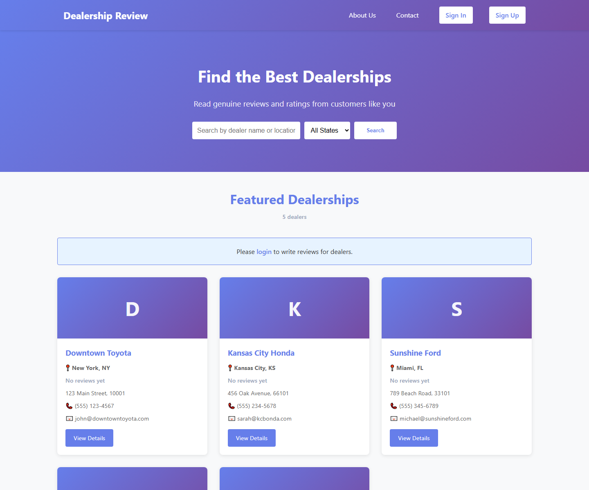
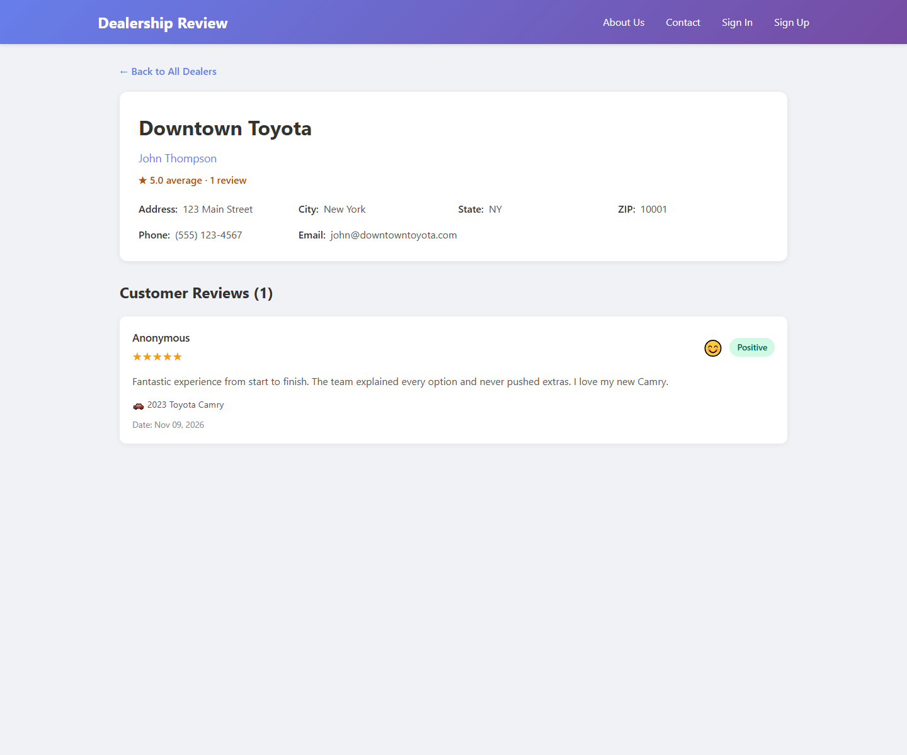
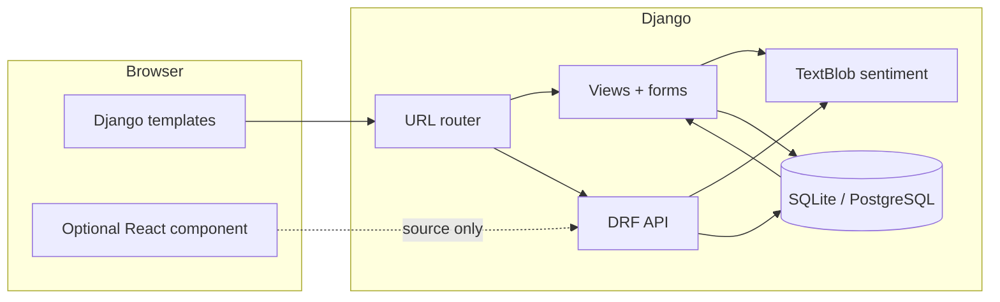

<div align="center">

# 🚗 Dealership Review

**A full-stack capstone project for browsing dealerships, reading real reviews, and posting your own with automatic sentiment analysis.**

[](https://www.djangoproject.com/)
[](https://www.django-rest-framework.org/)
[](https://www.python.org/)
[](https://www.sqlite.org/)
[](.github/workflows/django.yml)
[](#-license)

[**Browse the code**](https://github.com/BennyLinntu/dealership-review-app) ·
[**Report a bug**](https://github.com/BennyLinntu/dealership-review-app/issues) ·
[**Request a feature**](https://github.com/BennyLinntu/dealership-review-app/issues)

</div>

---

## 🖼️ Preview

<div align="center">
  
  <p><em>Search by dealer, city or state — with live rating summaries.</em></p>
</div>

<div align="center">
  
  <p><em>Dealer details, review history, star ratings and sentiment badges.</em></p>
</div>

---

## ✨ What it does

| | Feature | Details |
|---|---|---|
| 🔎 | **Find a dealer** | Search by business name, owner, city or state. State filters are generated from live data. |
| ⭐ | **Ratings at a glance** | Each card shows the average rating and number of reviews. |
| ✍️ | **Post a review** | Star rating, written review, car make/model/year and purchase date. |
| 🧠 | **Sentiment analysis** | TextBlob labels every review positive, neutral or negative and stores the polarity score. |
| 🔐 | **Token authentication** | Django REST Framework token login for API clients, session login for the website. |
| 👤 | **Registration** | Server-rendered sign-up flow with Django's password validators. |
| 🚘 | **Vehicle catalogue** | Car makes and models exposed through a read-only API. |
| 🧪 | **Tested** | 14 Django tests covering models, APIs, search, auth and review validation. |
| ⚙️ | **CI ready** | GitHub Actions runs lint, system checks, migration checks, tests and `collectstatic`. |

---

## 🧱 Architecture



**Stack**

- **Backend:** Django 5.2 LTS, Django REST Framework
- **Frontend:** Django templates + vanilla CSS; a React registration component is kept in `frontend/src` as reference
- **Database:** SQLite for local development
- **Auth:** session auth for pages, token auth for the API
- **Sentiment:** TextBlob polarity + subjectivity
- **Serving:** Gunicorn + WhiteNoise in production
- **CI:** GitHub Actions

---

## 🚀 Quick start

### 1. Clone and create a virtual environment

**Windows (PowerShell)**

```powershell
git clone https://github.com/BennyLinntu/dealership-review-app.git
cd dealership-review-app\server
python -m venv .venv
.\.venv\Scripts\Activate.ps1
python -m pip install --upgrade pip
pip install -r requirements.txt
```

**macOS / Linux**

```bash
git clone https://github.com/BennyLinntu/dealership-review-app.git
cd dealership-review-app/server
python3 -m venv .venv
source .venv/bin/activate
python -m pip install --upgrade pip
pip install -r requirements.txt
```

### 2. Set up the database

```bash
python manage.py migrate
python manage.py populate_data
python manage.py createsuperuser   # optional, for /admin/
```

`populate_data` adds five sample dealerships, five car makes across 2020–2024, and three reviews so the UI is not empty on first run.

### 3. Run it

```bash
python manage.py runserver
```

| URL | What is there |
|---|---|
| <http://127.0.0.1:8000/> | Dealer directory |
| <http://127.0.0.1:8000/dealer/1/> | Dealer details + reviews |
| <http://127.0.0.1:8000/register/> | Create an account |
| <http://127.0.0.1:8000/login/> | Sign in |
| <http://127.0.0.1:8000/admin/> | Django admin |

---

## 🔌 API

The API is browsable at `/api/dealers/` and uses token authentication for writes.

### Authentication

```bash
# Get a token
curl -X POST http://127.0.0.1:8000/api/login/ \
  -H "Content-Type: application/json" \
  -d '{"username":"your-user","password":"your-password"}'

# Use it
curl http://127.0.0.1:8000/api/dealers/ \
  -H "Authorization: Token YOUR_TOKEN"
```

### Endpoints

| Method | Endpoint | Description |
|---|---|---|
| `GET` | `/api/dealers/` | Paginated dealers with `average_rating` and `review_count` |
| `GET` | `/api/dealers/<id>/` | Dealer detail with reviews |
| `GET` | `/api/dealers/state/<state>/` | Filter by abbreviation or full name |
| `GET` | `/api/reviews/` | All reviews |
| `POST` | `/api/reviews/` | Create a review (sentiment is computed automatically) |
| `GET` | `/api/reviews/<dealer_id>/` | Reviews for one dealer |
| `GET` | `/api/cars/` | Car makes with nested models |
| `GET` | `/api/cars/makes/` | Car makes |
| `GET` | `/api/cars/models/` | Car models |
| `POST` | `/api/sentiment/` | Analyze arbitrary text |
| `POST` | `/api/login/` | Obtain an auth token |
| `POST` | `/api/logout/` | Revoke the current token |
| `POST` | `/api/register/` | Create an account and return a token |
| `GET` | `/fetchDealers` | Legacy capstone-compatible dealer list |
| `GET` | `/fetchReviews/dealer/<id>` | Legacy review payload, now backed by real car fields |

### Example review

```bash
curl -X POST http://127.0.0.1:8000/api/reviews/ \
  -H "Authorization: Token YOUR_TOKEN" \
  -H "Content-Type: application/json" \
  -d '{
    "dealer": 1,
    "rating": 5,
    "review_text": "Fantastic service and a very friendly team.",
    "car_make": "Toyota",
    "car_model": "Camry",
    "car_year": 2023,
    "purchase": true
  }'
```

```json
{
  "id": 4,
  "dealer": 1,
  "user": {"id": 2, "username": "demo"},
  "reviewer_name": "Demo User",
  "rating": 5,
  "review_text": "Fantastic service and a very friendly team.",
  "sentiment": "positive",
  "sentiment_score": 0.8,
  "car_make": "Toyota",
  "car_model": "Camry",
  "car_year": 2023,
  "purchase": true
}
```

---

## ⚙️ Configuration

See [`.env.example`](.env.example). The important production values:

| Variable | Purpose |
|---|---|
| `SECRET_KEY` | Long random Django secret (required in production) |
| `DEBUG` | `false` in production |
| `ALLOWED_HOSTS` | Comma-separated hostnames |
| `CSRF_TRUSTED_ORIGINS` | Full HTTPS origins, e.g. `https://example.com` |
| `TRUST_PROXY` | `true` behind a reverse proxy |
| `SECURE_COOKIES` | `true` when serving over HTTPS |
| `SECURE_SSL_REDIRECT` | Redirect HTTP to HTTPS |
| `CORS_ALLOWED_ORIGINS` | Comma-separated origins for a separate frontend |
| `LOG_LEVEL` | Python logging level |

Quick local override:

```powershell
$env:DEBUG = "true"
$env:SECRET_KEY = "local-only-key"
python manage.py runserver
```

---

## 🧪 Testing

```bash
cd server
python manage.py test -v 2
```

Coverage includes:

- ✅ average rating and review-count annotations
- ✅ review API sentiment + car fields
- ✅ short-review validation
- ✅ token login (after fixing the `/api/login/` route shadowing bug)
- ✅ search and full-state-name filtering
- ✅ HTML review creation and validation
- ✅ registration flow
- ✅ legacy `fetchReviews` and car endpoints

CI runs the same suite on Python 3.12 with a fresh database.

---

## 📁 Project structure

```text
dealership-review-app/
├──  .github/workflows/django.yml   # lint, checks, tests, collectstatic
├──  docs/                          # README screenshots
└──  server/
    ├──  manage.py
    ├──  requirements.txt
    ├──  dealership_project/        # settings + root URLs
    ├──  djangoapp/
    │  ├──  models.py              # Dealer, Review, UserProfile
    │  ├──  views.py               # pages + API views
    │  ├──  serializers.py         # DRF serializers
    │  ├──  sentiment.py           # TextBlob wrapper
    │  ├──  forms.py               # registration form
    │  ├──  tests.py               # 14 tests
    │  └──  migrations/
    ├──  vehicles/                  # CarMake + CarModel API
    └──  frontend/
        ├──  index.html
        ├──  login_page.html
        ├──  register_page.html
        ├──  static/
        │  ├──  dealer_detail.html
        │  ├──  post_review.html
        │  └──  style.css
        └──  src/                   # optional React registration component
```

---

## 🐛 Fixes in this revision

- 🧭 `/api/login/` was being shadowed by DRF's browsable login route; moved DRF auth URLs to `/api-auth/`.
- 🚗 Reviews now persist car make, model, year, purchase flag and purchase date instead of returning hard-coded Toyota Camry data.
- 🔎 The homepage search box actually filters results; state options come from the database rather than a hand-written list.
- ⭐ Dealer cards show real average ratings and review counts.
- 🧠 Sentiment logic is centralised in one helper for HTML, API and legacy endpoints.
- 🖼️Removed broken external vehicle images in favour of reliable gradient covers.
- 🔐 Production-ready settings with environment variables, WhiteNoise and security headers.
- 🧪 Added migrations, 14 tests and a working CI workflow.
- 📝 Added a real registration page (`/register/`) instead of a dead link.

---

## 🗺️ Roadmap

- [x] Real review vehicle data + migration
- [x] Search, state filtering and rating summaries
- [x] Registration, validation and CI
- [ ] Dealer map with Leaflet
- [ ] Pagination / infinite scroll on the directory
- [ ] Review photos and dealer responses
- [ ] PostgreSQL deployment profile with Docker Compose

---

## 👤 Author

**Benny Lin** · [@BennyLinntu](https://github.com/BennyLinntu)

## 📄 License

MIT — see the repository for details.

<div align="center">
  <br />
  <strong>Found a dealership worth reviewing? ⭐ the repo if this project helped you.</strong>
</div>

